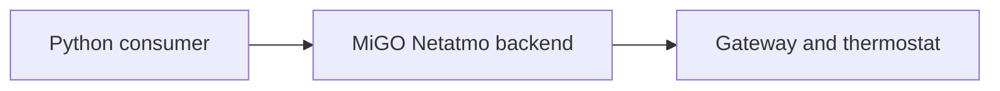
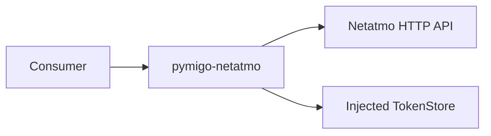

# Architecture

The library owns account access, response interpretation and wire conversions.
Consumers own scheduling, user interface and credential persistence policy.

## 1. Context

## 2. Containers

## 3. Components

| Package | Responsibility |
|---------|----------------|
| `client` | Resource services, authentication and HTTP boundary |
| `system` | Account snapshots, gateway pairing and home-scoped writes |
| `models` | Tolerant dataclasses, wire types and pure interpretation |
| `const` | Wire values, semantic enums and limits |
| `tokens` | Async persistence protocol, memory and private file stores |
| `testing` | Offline fake for consumers |
| `cli` | Command line over the `system` façade: account reads and confirmed writes, see [command line reference](cli.md) |

Snapshot assembly merges static configuration, module configuration and live status
in that order. Missing optional reads retain the account where possible. Authentication
errors propagate. Consumption preserves the last valid record when a later read has
no usable data, matching the original integration contract.

## 4. Release

Publish the library before pinning a consumer release. Trusted publishing requires
configuring this repository as a publisher in PyPI. The workflow alone does not grant
that authorization. Consumer integration tests must run against the built wheel before
release. Test HTTP servers bind only to loopback and never use real credentials.
